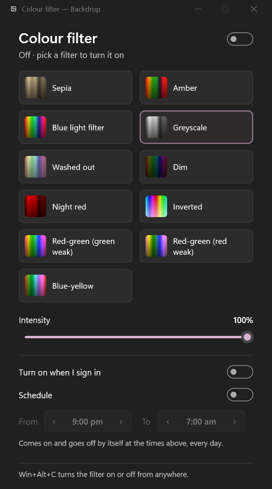

# Backdrop

https://github.com/user-attachments/assets/982a6081-589e-4bf8-a705-9a0f701e1d26

A tiny Windows tray app that does a few things well:

- **Video wallpaper**: any video, GIF or WebP plays behind your desktop icons, starts the moment you sign in, and pauses when you're not looking at the desktop.
- **Colour filters for the whole screen**: sepia, amber, greyscale, blue-light and more, each with a strength slider, a sign-in default and a daily schedule. Windows' own colour filters only offer a few, have no intensity setting, and are buried in Settings.
- **Blur for the whole screen**: a slight, adjustable blur that softens everything at once, on its own or together with any colour filter. Handy when the screen is just too much.
- **Desktop widgets** you make with plain HTML, CSS and JavaScript: clocks, GIFs, live feeds, little games. They sit on your wallpaper, under every window.

Plus a one-click (or **Win + Alt + H**) show/hide for your desktop icons, and a proper settings app for all of it.

The core is one small native exe (~450 KB). The app window and widgets run in a separate process that only starts when you use them, so the wallpaper and filter are just as fast as ever. No admin rights, no background services, no telemetry, and Backdrop itself never goes online. Made by Abinaash ([MilkmanAbi](https://github.com/MilkmanAbi)).

<p align="center"></p>

## Install

1. Download **`Backdrop-Setup-1.4.0.exe`** from [Releases](https://github.com/MilkmanAbi/Backdrop/releases/latest).
2. Run it. Windows will probably show a blue **"Windows protected your PC"** screen. Click **More info**, then **Run anyway**. That screen appears for any app that isn't code-signed, which costs money every year; it doesn't mean anything was found.
3. Backdrop appears next to the clock, asks you to pick a video or GIF, and from then on starts by itself every time you sign in.

No admin rights needed. It installs just for you, to `%LOCALAPPDATA%\Programs\Backdrop`. Requires 64-bit Windows 10 (1809) or Windows 11.

### If Windows says "Smart App Control blocked an app"

Most PCs never show this, because Smart App Control is usually already off. If yours blocks Backdrop:

1. Open Start, type **security** and open **Windows Security**.

   

2. Go to **App & browser control**, then **Smart App Control settings**.

   

3. Choose **Off**, then run the installer again.

   

Turning Smart App Control off means Windows stops blocking *all* unknown apps, not just this one. On some Windows versions you also can't turn it back on without resetting Windows. Only do it if you're happy with that. Windows Defender antivirus keeps protecting you either way.

## Made by

**Abinaash ([MilkmanAbi](https://github.com/MilkmanAbi))**. I built Backdrop because Windows' colour filters were too limited and hard to toggle, and I wanted my favourite video as my wallpaper without a heavy app running in the background. Sharing it with my friends, and now you.

### Is it safe?

Yes. And you don't have to take my word for it:

- **All the code is right here**: C++, HTML, CSS and JS you can read, and build yourself with `build.bat`.
- **It never touches the internet.** No accounts, no telemetry, no update pings. (Widgets you add are web pages and can do whatever you write them to do, including fetching things online. The built-in ones don't.)
- **No admin rights, no drivers, no services.** It runs as you, like any normal app, and only changes your own settings.
- **Clean uninstall.** Use the tray menu (**Uninstall Backdrop**) or Settings → Apps, and everything is removed: the app, its settings, its startup entry and its cache.
- The colour filter uses Windows' own built-in screen colour transform, the same one Windows' colour filters use. If Backdrop is ever closed, your screen goes straight back to normal.
- The blur works on a copy of your screen that stays on your graphics card: it's never saved, sent anywhere or seen by any other app. Close Backdrop and it's gone.

## Using it

Open **Backdrop** from the Start menu (or **Open Backdrop…** in the tray menu) for the settings app: wallpaper, colour filter, desktop icons and widgets, all in one window. Everything is also one click away from the tray icon:

| Menu item | What it does |
|---|---|
| **Open Backdrop…** | Opens the Backdrop app. |
| **Colour filter: Sepia 70%** | Turns the filter on or off. The shortcut **Win + Alt + C** works anywhere. If another app already uses it, Backdrop picks a free one and shows it in the menu. |
| **Colour filters…** | Opens the filter window: pick a filter, drag the slider, and see it live on the whole screen. |
| **Blur: 50%** | Turns the blur on or off. The shortcut **Win + Alt + Z** works anywhere (or a free one shown in the menu). |
| **Show desktop icons** | Hides or shows all your desktop icons in one click, for a clean screen or some privacy. The shortcut **Win + Alt + H** works anywhere. It flips Windows' own setting (the same as right-click → View → Show desktop icons), so it's remembered after a restart. |
| **Video wallpaper on** | Turns the wallpaper on or off. When off, it unloads completely and uses about 9 MB of RAM. |
| **Choose video or GIF…** | MP4, MOV, AVI, MKV, WMV, GIF (including transparent ones) and WebP (including animated ones). |
| **Fit** | Fill (crop), Fit (black bars), Stretch, or Center (original size). |
| **Uninstall Backdrop…** | Removes everything. You can also uninstall from Settings → Apps. |

### Colour filters

Sepia, Amber, Blue light filter, Greyscale, Washed out, Dim, Night red, Inverted, and three colour-blind friendly filters: Red-green (green weak), Red-green (red weak) and Blue-yellow.

- **Intensity:** 0–100% for every filter, applied live with a smooth fade.
- **Turn on when I sign in:** the filter goes on within a fraction of a second of Backdrop starting at sign-in. Otherwise it starts off each time you sign in.
- **Schedule:** on and off at set times every day (it can run overnight, e.g. 9 pm to 7 am). Switching it by hand still works, and the next scheduled time takes over again. It keeps time correctly across sleep, clock changes and daylight saving.
- Remembers your filter and strength.

Filters use Windows' own full-screen colour transform, the same one Windows' built-in colour filters use. It works on everything, including games, videos and the taskbar, costs nothing, and switches off instantly if Backdrop is ever closed.

### Blur

A slight blur over the whole screen, for when sharp detail and busy pages get overwhelming. It sits side by side with the colour filters: use either, or both at once.

- **Strength:** 10–100%, live, in the filter window (bottom row) or the Backdrop app. 100% is a hard limit: even at full strength small text stays readable, so you can always find the switch to turn it off again.
- **Always starts off** when Backdrop starts. Only the strength is remembered.
- **Win + Alt + Z** turns it on or off from anywhere, and so does the tray menu.
- Your mouse pointer stays sharp. Clicks, typing and scrolling go straight through to your apps as usual.
- Screenshots and screen shares show your screen *without* the blur, so what you share stays readable for others.
- Video with copy protection (some streaming sites) can't be copied, so it can't be blurred either: while it's on screen, that screen shows without the blur.

How it works: Windows has no built-in screen blur, so Backdrop copies the screen on the graphics card (Desktop Duplication), blurs only the parts that changed, and shows the result in a click-through window above everything that is left out of screen captures. While your screen isn't changing it does no work at all; while video or animation is playing it uses a little CPU and some of your graphics card.

### Video wallpaper

- When you pick a file, Backdrop converts it once on the GPU into a video at your display's exact resolution. Playback then never has to resize anything, which keeps it light.
  - Phone videos are turned the right way up.
  - Short GIFs are looped smoothly.
  - Converted files are cached, so switching fit modes back and forth is instant.
- Warns you when a file's resolution is too low for your screen, and tells you the ideal size.
- Pauses when a maximised or full-screen window covers the desktop, when the PC is locked, and when the display is off.
- Plays muted with hardware decoding.

### Widgets

Widgets are little web pages that live on your desktop. Turn them on in **Backdrop → Widgets**, add the built-in Clock, Calendar or Moon phase, or add your own `.html` file or `.zip`.

- They sit on the wallpaper, **under every window**, never on top. They have no taskbar button and don't show in Alt+Tab or Task View, and **Win + D** shows them along with the desktop.
- **Right-click** a widget: **Arrange widgets**, **Snap to** a corner or the centre, **Remember position**, **Reload**, **Open widget folder**, **Backdrop settings…**, **Close widget**.
- **Arrange widgets** (also a button in the app, or `backdrop-ui.exe /arrange`) dims the screen, leaving the taskbar clear, and draws a grid with an outline around every widget. Drag widgets and each one snaps into the grid squares it covers, centred, so everything lines up with even spacing. The bar at the bottom has **Grid** / **Free move** (no grid, drop anywhere), **Auto grid** (picks the grid size your widgets fit best and snaps them to it) and the grid **Size**. **Esc** or **Done** to finish.
- **Resize any widget**: drag the corner handle in Arrange, or right-click → **Size** (50% to 300%). The whole widget scales evenly, like a picture: text, images, GIFs and shapes together. **Reset to original size** puts it back. Sizes are remembered.
- Arrange has PowerPoint-style **smart guides**: dashed lines when a widget's edges or centre line up with another widget or the middle of the screen, and arrows with the gap when spacing matches. Guides win over the grid; hold **Alt** while dragging to place freely.
- Positions are remembered. With **Open widgets when I sign in** on, they start *after* the wallpaper and filter are up, at low priority, so sign-in doesn't get any slower.
- The empty space around a widget's elements is see-through **and click-through**: clicks land on your desktop icons behind it.
- Widgets run at **24 fps** by default. An animated GIF widget uses about 5–8% of one CPU core (around 1% of a whole 4-core laptop CPU); a clock barely registers. The widget process takes roughly 30–70 MB of RAM depending on how many widgets are open, and only runs while you use widgets or the app.

#### Make your own

A widget is one `.html` file, or a `.zip` with an `index.html` plus its images, fonts and scripts. A `.html` file is used where it is, so images next to it just work and your edits show up when you right-click → **Reload**.

```html
<!doctype html>
<html>
<head>
  <meta charset="utf-8">
  <title>Autumn</title>                                    <!-- the name shown in Backdrop -->
  <meta name="widget-size" content="400x168">              <!-- window size in CSS px (default 360x240) -->
  <style>
    img { display: block; width: 400px; height: 168px; border-radius: 22px; }
  </style>
</head>
<body></body>
</html>
```

| You want | Do this |
|---|---|
| Size | `<meta name="widget-size" content="WxH">` in CSS pixels. |
| Smoother animation | `<meta name="widget-fps" content="60">` (default 24, max 240). |
| Rounded corners, circles, pills | `border-radius`, as usual. The page background is transparent. |
| Any other shape | `data-shape="M100,185 C45,145 0,112 0,58 … Z"` (an SVG path in CSS px) on an element with a `background-image`. The background (GIFs too) is cut to that shape. |
| Your own right-click menu | Handle the `contextmenu` event and return `true`; otherwise Backdrop's menu shows. |
| Whole rectangle clickable | `<meta name="widget-clickthrough" content="off">` (by default the space around your top-level elements clicks through; call `backdropReshape()` after changing the layout). |
| Keyboard input (games, text boxes) | `<meta name="widget-keyboard" content="on">`. Otherwise clicking a widget never takes the focus from your apps. |
| A close button, etc. | `backdrop.close()`, `backdrop.menu()`, `backdrop.openApp()`. |
| Run commands on your PC | `await backdrop.run("...")`, see below. |
| Internet, sockets, eval | All allowed: `fetch`, `WebSocket`, timers, canvas, CSS animations and Sciter's `@sys` / `@env` modules. |
| See `console.log` output | Start `backdrop-ui.exe` with the environment variable `BACKDROP_LOG=1`; output goes to `%LOCALAPPDATA%\Backdrop\widgets.log`. |

#### Running commands from a widget

```js
const r = await backdrop.run("Get-CimInstance Win32_Battery | Select -Expand EstimatedChargeRemaining");
// r = { ok: true, code: 0, stdout: "87\r\n", stderr: "", error: "", timedOut: false }

await backdrop.run("ipconfig /all", { shell: "cmd" });            // cmd.exe instead of PowerShell
await backdrop.run("whoami", { shell: "none" });                  // run a program directly
await backdrop.run("Restart-Service Spooler", { admin: true });   // Windows asks with the usual UAC prompt
await backdrop.run("Start-Sleep 30", { timeout: 5000 });          // give up after 5 s (default 60 s, 0 = never)
```

Commands run hidden (no console window flashes up), in Windows PowerShell unless you pick `cmd` or `none`, and the widget keeps running while they work. With `admin: true`, stdout and stderr come back together in `stdout`.

**Only add widgets you trust.** A widget can run anything on your PC that you can, the same as any program you download.

Widgets are rendered by [Sciter](https://sciter.com/), a small HTML/CSS/JS engine, not a full browser. Most everyday HTML and CSS works; a few newer CSS features (`clip-path`, for example) don't, which is why `data-shape` exists.

## Build from source

Needs Visual Studio 2022 or 2026 with the C++ workload, CMake, and the [Sciter.JS SDK](https://gitlab.com/c-smile/sciter-js-sdk) in `third_party\sciter-js-sdk` (for its headers and `sciter.dll`). [Inno Setup 6](https://jrsoftware.org/isinfo.php) is only needed for the installer. The blur shaders are compiled by `fxc`, which comes with the Windows SDK in that workload.

```bat
get_libwebp.bat   :: once: fetches and builds libwebp (animated WebP support)
build.bat         :: backdrop.exe, backdrop-ui.exe, stage\ (the install layout) and dist\Backdrop-Setup-x.y.z.exe if Inno Setup is installed
```

| File | What's in it |
|---|---|
| `backdrop.cpp` | Tray app, wallpaper playback (Media Foundation → D3D11), desktop placement, install and uninstall |
| `convert.cpp` | One-time GPU conversion (decode → D3D11 video processor → hardware H.264) |
| `filter.cpp` | Colour matrices, fades, schedule |
| `blur.cpp`, `blur.hlsl` | The whole-screen blur (Desktop Duplication → D3D11 blur → DirectComposition window) |
| `panel.cpp` | The colour filter window (Direct2D) |
| `theme.cpp` | Follows Windows light/dark mode and your accent colour |
| `ui\backdrop-ui.cpp` | The app window and widgets process (Sciter): widget windows, their menu, frame-rate cap, talking to the core |
| `ui\app\` | The Backdrop app (HTML, CSS, JS) |
| `widgets\` | Built-in widgets |

## Licence

MIT, see [LICENSE](LICENSE). Backdrop includes [libwebp](https://chromium.googlesource.com/webm/libwebp) (BSD), the [Lucide](https://lucide.dev) "image" icon (ISC) and the [Sciter](https://sciter.com/) engine (free licence, Terra Informatica Software); see [THIRD-PARTY-NOTICES.txt](THIRD-PARTY-NOTICES.txt).

This Application (or Component) uses Sciter Engine (http://sciter.com/), copyright Terra Informatica Software, Inc.
